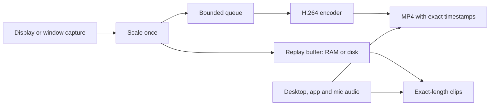

# Recorder Test

A Windows screen recorder and instant-replay studio built for ordinary hardware. It records your screen or a single app, keeps the last few seconds or minutes ready to save, and adapts to what your PC can actually handle.

Written in Python, with a dashboard, global hotkeys and an overlay that never shows up in your recordings.

> **Status:** in active development. The current timing and encoding pipeline is new and hasn't been widely tested on other hardware yet. Bug reports with the console output are very welcome.

## Why use it on a low-end PC

Most of the work in a recorder is encoding, and a weak PC can't always keep up. These design choices keep recordings usable when that happens.

| What it does | What you get |
|---|---|
| **Tests the encoders on your PC.** Each H.264 encoder is speed-tested at your resolution, frame rate and bitrate, and the first one that keeps up with room to spare is used. | No guessing. A GPU encoder isn't assumed to be faster: on the Iris Xe laptop this was developed on, Quick Sync measured slower than x264 on the CPU. |
| **Stores each screen image once, at the moment it appeared** (variable frame rate). | Pixels that don't change cost almost nothing, so a mostly still desktop needs far less encoding than a fixed 60 FPS stream. |
| **Skips frames evenly under overload.** The encoder queue holds at most half a second. | No freezes followed by a sped-up catch-up. Video and audio stay in sync with real time, just with fewer distinct frames. |
| **Scales frames once, right after capture.** | Choosing 720p lightens the encoder, the replay buffer and the preview together. |
| **Keeps capture ahead of encoding in priority.** Capture threads run above normal priority, encoding below normal, and clip exports at low priority. | Saving a clip doesn't compete with capture or your game for CPU time. |
| **Moves long replays to disk.** Buffers that would use more than 25% of your RAM are written as rolling 2-second segments. | Up to 60 minutes of replay without needing huge amounts of memory. |
| **Does no work for features you turn off.** A disabled overlay or replay buffer has no thread and no buffer. The dashboard redraws at 30 Hz whatever the capture rate. | Spare CPU goes to the recording. |

## Features

### Recording
- Frame rates from **15 to 240 FPS**, changeable while running.
- Output at native resolution, 2160p, 1440p, 1080p, 720p or 480p. Video is never upscaled.
- Low, Medium, High and Ultra quality presets, or a custom bitrate from 1 to 150 Mbps.
- H.264 through NVIDIA NVENC, Intel Quick Sync, AMD AMF or x264, chosen automatically.
- Automatic retry on the next encoder if one fails.
- A warning in the dashboard when the encoder starts falling behind.

### Instant replay
- Always-on buffer from **5 seconds to 60 minutes**, saved with one key.
- Short buffers stay in RAM. Long ones go to disk, with a warning if free space is too low.
- Clips come out at the exact length you set. Most of a long clip is joined without re-encoding, so it saves quickly.

### Capture sources
- Any display, or a single application window (needs `windows-capture`).
- Switch sources in the middle of a recording, without starting a new file.
- A hotkey locks capture onto the window you're using.
- Captured windows are restored without taking focus if minimized, because Windows doesn't draw minimized windows.
- If a captured window closes, capture returns to a display.

### Audio
- Desktop audio and microphone, timestamped by Windows and placed on the video timeline separately.
- **All Apps** mode with individual apps blocked, or **Only Selected Apps** mode for per-app capture.
- Mix everything into one stream, or also keep one stream per source for editing.

### Interface
- Dashboard with Recordings, Clips, Source and Settings tabs that adapts to any window size.
- Gallery with thumbnails, exact lengths, and play and delete buttons.
- Live overlay showing FPS, source, elapsed time and hotkeys, with a drag-to-position preview. It's excluded from capture, and it turns itself off if Windows can't confirm that exclusion.
- Rebindable global hotkeys with conflict detection.
- Settings are saved between sessions.

## Requirements

- **Windows 10 or 11.** The app is Windows-only.
  - The overlay needs Windows 10 version 2004 or newer.
  - Per-app audio needs Windows 10 build 20348 or newer, or Windows 11.
- **Python 3.10 or newer.** Developed on Python 3.15.
- No separate FFmpeg install. The Python packages include it.

## Installation

```powershell
git clone https://github.com/neelendu-c/Recorder-test.git
cd Recorder-test
python -m venv .venv
.\.venv\Scripts\activate
pip install -r requirements.txt
```

## Usage

```powershell
python main.py
```

On first launch, the app tests the encoders in the background for a few seconds. The screen may hitch once during this. Results are saved for 24 hours, and the chosen encoder is printed in the console.

Recordings are saved to `Recordings/` and clips to `Clips/`.

### Hotkeys

| Default | Action |
|---|---|
| **F9** | Start or stop recording |
| **~** | Save an instant replay clip |
| **P** | Pause or resume |
| **F10** | Lock onto the foreground window (press again to return to the display) |
| **F8** | Microphone on or off |
| **Esc** | Exit (only while the dashboard has focus) |

Change these in **Settings › Hotkeys**. They work in every app and don't block the key, so pressing **P** while typing elsewhere also pauses your recording. If that gets in the way, rebind it to a combination or an F-key.

## Getting the best results on a slow PC

In rough order of impact:

1. **Plug in your laptop.** Windows slows the CPU and GPU down on battery.
2. **Lower the output resolution** in Settings › Video. 720p is about 2.25× less work per frame than 1080p.
3. **Record at 30 FPS** instead of 60.
4. **Cap your game's frame rate** a little below what it reaches, to leave room for the recorder.
5. **Use a short replay buffer while recording.** A buffer long enough to go to disk runs a second encoder alongside the recording.

## How it works



- **Capture** polls the display at twice its refresh rate, so no update is missed, and stamps each frame with the time Windows presented it.
- **Encoding** runs in-process through PyAV. If PyAV is missing, the app pipes frames into FFmpeg instead, and OpenCV is the last fallback.
- **Recovery:** if Windows interrupts screen capture, for example on a display mode change, capture restarts automatically and the recording continues. A pause or stall longer than 0.5 seconds is cut from both video and audio.

## Good to know

- **It's lighter on still screens, not free under heavy load.** Frames are copied from the GPU to system memory and colour-converted on the CPU. Recorders that keep frames on the GPU, like OBS and NVIDIA ShadowPlay, have the advantage while a demanding game is running. Here, the recording stays in sync but can have fewer distinct frames.
- **The FPS counter shows new images per second.** It drops to about 10 on a still screen, because the last image is only repeated every 0.1 seconds.
- **A display can't deliver more frames than its refresh rate.** On a 60 Hz screen, settings above 60 FPS add no new frames. A game running at 25 FPS records as 25 distinct frames per second.
- **Recording with a disk replay buffer runs two encoders.** They aren't shared yet.

## Configuration

Most options are in the dashboard and saved to `user_settings.json`. Defaults and advanced options are in `config.py`:

| Setting | Default | Purpose |
|---|---|---|
| `CLIP_ENCODER` | `"auto"` | `"auto"`, `"x264"` or `"opencv"` |
| `REPLAY_RAM_BUDGET_MB` | `None` | RAM limit before replay moves to disk (`None` means 25% of installed RAM) |
| `REPLAY_SEGMENT_SECONDS` | `2` | Length of each disk replay segment |
| `SCALE_INTERPOLATION` | `"linear"` | `"linear"` is fastest, `"area"` is smoother |
| `AUDIO_SYNC_OFFSET_MS` | `0` | Manual audio delay (positive values move audio later) |
| `AV_GAP_CUT_SECONDS` | `0.5` | Longer gaps are cut from video and audio |
| `UI_REFRESH_HZ` | `30` | Dashboard redraw rate |

## Project layout

```
Recorder-test/
├─ main.py             # Entry point and capture loop
├─ config.py           # Defaults and saved settings
├─ screen_capture.py   # Display and window capture, output canvas
├─ video_writer.py     # Encoder selection, writers, A/V timeline, muxing
├─ replay_buffer.py    # RAM and disk replay, clip export
├─ audio_capture.py    # WASAPI desktop, microphone and per-app capture
├─ video_recorder.py   # PyAudioWPatch fallback for desktop audio
├─ ui_dashboard.py     # Dashboard
├─ overlay.py          # FPS counter and capture-excluded overlay
├─ hotkeys.py          # Rebindable global hotkeys
├─ media_info.py       # Thumbnails and durations for the gallery
├─ win32_api.py        # Win32 bindings
├─ win32_process.py    # Process list for per-app audio
└─ requirements.txt
```

## Contributing

Pull requests are welcome. Please keep the UI style consistent and update this README when behaviour changes. There's no automated test suite yet, so include how you checked your change.

## License

Released under the MIT License.
